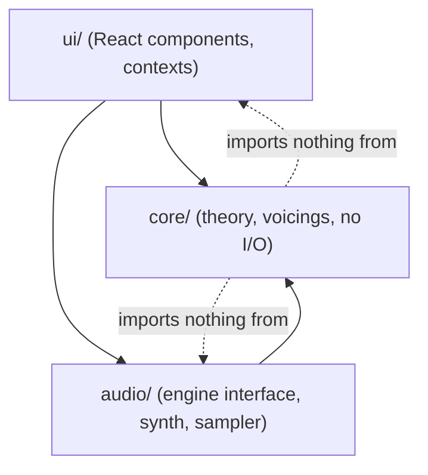
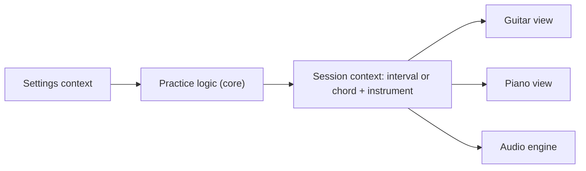

# Architecture Spine — accompa

## Design Paradigm

Ports-and-adapters. The music-theory **core** is pure TypeScript with no React, no DOM and no audio. The **audio engine** and the **React UI** are adapters around it. Dependencies point inward only.



## Invariants & Rules

FR-21 is withdrawn. Its piano inversions are FR-27 (Phase 2), solved by AD-8 without a piano voicing generator. Voicings are generated for the guitar only.

### AD-1 — Dependency direction

- **Binds:** all
- **Prevents:** theory logic leaking into components, or audio details leaking into theory.
- **Rule:** `core/` imports nothing from `ui/` or `audio/`, and uses no browser APIs. `audio/` may import `core/` types only. `ui/` may import both. Enforce with an import-boundary lint rule.

### AD-2 — Pitch is an integer

- **Binds:** FR-3, FR-4, FR-10, FR-12, FR-14, FR-15, FR-16, FR-22
- **Prevents:** the piano view, fretboard, voicing generator and audio disagreeing about what a note is.
- **Rule:** In `core/`, absolute pitch is a MIDI note number (60 = middle C), pitch class is `n mod 12`, and an interval is a semitone count. They are distinct branded TypeScript types (`Pitch`, `PitchClass`, `Interval`), so the compiler stops them mixing. No note-name strings are stored, passed between modules, or compared. A spelled note is a struct of integers (`letter` 0 to 6, `accidental` as a semitone offset), never a string. **[ADOPTED]**

### AD-3 — Spelling is a display function

- **Binds:** FR-4, FR-12, FR-14, FR-15, FR-24, FR-27, FR-33
- **Prevents:** two views labelling the same chord tone differently (C♯ vs D♭, or a wrong dim7 spelling).
- **Rule:** One `core/spelling` module turns pitches into labels. Chord tones are spelled by letter-name stepping from the spelled root. The letter step comes from the tone's degree in its quality record (AD-4): 2nd or 9th = +1, 3rd = +2, 4th = +3, 5th = +4, 6th = +5, 7th = +6, with accidentals as needed and never a double accidental (the twin rule of `core/spelling` applies). A chord's root is a spelled note (`letter` and `accidental`, AD-2), not a pitch class: a namer reading and a picked chord both carry it, so two surfaces cannot label the same root C♯ and D♭. Root spelling comes from the namer's chosen reading (AD-10), the user's explicit root change, or a picker's explicit choice (AD-10, AD-12); a default table (D♭, E♭, G♭, A♭, B♭ flat; C♯, F♯ sharp) applies where none exists. Interval spelling: each of the 12 intervals has one fixed name in the interval table (m2, M2, m3, M3, P4, A4, P5, m6, M6, m7, M7, P8; 6 semitones is always A4), and the upper note is spelled by that interval's letter step. No component spells notes itself. **[ADOPTED]**

### AD-4 — One table per music concept

- **Binds:** FR-7, FR-12, FR-14, FR-20, FR-22, FR-24, FR-26, FR-28, FR-29
- **Prevents:** the interval pool, the reveal text, the chord builder, the drill and the ear-practice pool each keeping their own list of intervals or chord qualities, and chord logic that assumes every quality is root, 3rd, 5th, 7th by position.
- **Rule:** Interval definitions (semitones, name, abbreviation) and chord quality definitions live once as data in `core/theory`. A quality is a list of **tone records**, each with its semitones above the root, its degree (1, 2, 3, 4, 5, 6, 7 or 9) and its role (`root`, `third`, `fifth`, `seventh`, `ninth`, `fourth`, `sixth`). A tone's semitones are stored as a pitch-class offset (0 to 11), so a 9th is stored as 2 with degree 9; its octave placement is derived, never stored, and tones are ordered by degree. The `intervals` list is derived from the tones and the namer keeps comparing offsets mod 12. The 2nd and the 9th share the `ninth` role and the 4th is `fourth`; marker shapes, legend words and spelling letter steps all read the tone record, never the position in the list. Phase 2 has 17 qualities: the nine of Phase 1 plus sus2, sus4, 6, m6, add9, 9, maj9, m9. One boolean on the quality marks those Listen practice may use (the original nine, FR-26); Listen's pool and the `chordPool` default are derived from the flagged qualities, while the builder and the drill use all 17. UI lists, practice pools, the namer, the voicing generator, the drill and `core/keys` all derive from this table. Adding a quality means adding one entry. Shape templates are optional (AD-9). **[ADOPTED]**

### AD-5 — Session model is instrument-independent

- **Binds:** FR-1, FR-2, FR-10, FR-12, FR-15, FR-16, FR-19, FR-22, FR-27, FR-28, FR-29
- **Prevents:** state that resets or diverges when the user swaps instruments, practice rounds overwriting what the user built, and views owning musical state.
- **Rule:** Session types are plain data defined in `core/model` (reducers live in `ui/`). The session has two separate parts, each with one writer:
  - **workspace** (written only by builder, free-play, inversion stepping and voicing editing): the lit `pitches` (the single truth for what sounds and what is named), the guitar `positions` where notes were lit on the guitar, the chosen reading and root, the selected guitar voicing as frets with its edited flag, and an optional `bass` (the pitch class of one of the chord's own tones; absent means root position). `bass` is pruned whenever the lit notes change by hand or no longer contain it. Positions, the voicing and the inversion survive an instrument swap and swapping back.
  - **practice** (written only by practice rounds, Listen and the chord drill): Listen's `question` and `chordQuestion`, the reveal state and the pool in play, plus the drill's own slot: its asked chord, its attempt count and its lit notes in the workspace's shape (`pitches` and `positions`), edited by the same pure helpers (`placeLit`, `pitchesOnString`). The drill never reads or writes Listen's questions or the workspace.

  Practice never writes to the workspace. The active instrument is separate from both. The circle page keeps its own page-local state (AD-12) and writes neither part. A view is a pure render of session state.

### AD-6 — State lives in Context plus reducer

- **Binds:** FR-1 to FR-33 (UI)
- **Prevents:** ad hoc component state, and audio mixed into React state.
- **Rule:** React Context with a reducer, split into a **settings** context (interval pool, direction, root mode, sound, theme, mark misses, rail collapsed) and a **session** context (current interval or chord, instrument, voicing selection). Only sound, theme, interval pool, mark misses and rail collapsed persist to `localStorage`, each under its own key and read synchronously before the first render; direction, root mode, chord, voicing, the circle page's key, the drill question and every other value do not. Sound is `samples` or `synthesized` and defaults to `samples`; it is stored under the new key `accompa.sound.v2`; the Phase 1 key `accompa.sound` is never read and never deleted, so its stale `synthesized` value is ignored, and a deliberate `synthesized` choice under the new key is remembered. Mark misses defaults to on; the rail defaults to collapsed. State is plain and serializable. Playing a sound is a command to the audio engine, never React state. No other state library is added unless Context demonstrably fails. **[ADOPTED]**

### AD-7 — Audio engine is one interface

- **Binds:** FR-3, FR-11, FR-13, FR-19, FR-20, FR-10, FR-23, FR-30, FR-31, FR-33
- **Prevents:** components creating Web Audio nodes, and the synth-to-samples change touching the UI.
- **Rule:** `audio/` exposes one engine interface: play an **ordered list** of absolute pitches, with the instrument as a parameter of `play`, as a block, an arpeggio (in list order, so a descending interval plays descending) or a strum (bass to treble), and stop. Replay repeats the same list. The engine owns note timing; callers pass no timestamps. Components call only that interface. Phase 2 adds a **sampler engine** beside the synth behind the same interface. The Samples or Synthesized setting picks the engine; with Samples the instrument picks the sample set (piano samples on the piano, guitar samples on the guitar, in every section), and Synthesized ignores the instrument. The set for the active instrument loads at startup and again when the instrument changes, from same-origin static assets, and stays in memory. The engine reports its status (idle, loading, running, blocked or failed) and the UI shows loading and failed in the Status note. A note played while its set loads goes through the synth, so a click is never silent. A set that fails to load falls back to the synth for that instrument for the rest of the session and shows a message; theory features never break. Where a surface has no instrument (the circle page) it passes the session's last active instrument. A pitch between two sampled notes uses the nearest sample, shifted. "No network calls" (NFR2) means no third-party requests: bundled same-origin files are allowed. The sample format is one that all four target browsers play, chosen in the story. The `AudioContext` is created or resumed synchronously inside a user gesture handler (click or keydown), with no enable-sound screen. The engine treats a `suspended` context as "not ready" and resumes it on the next gesture. **[ADOPTED]**

### AD-8 — Voicings: one shape, generation separate from ranking

- **Binds:** FR-16, FR-17, FR-18, FR-19, FR-20, FR-24, FR-25, FR-27
- **Prevents:** guitar and piano voicings needing different naming and audio paths, ranking rules tangled into generation, an omission rule that breaks on sus, sixth and ninth chords, and a second inversion model beside the bass.
- **Rule:** A voicing is an ordered list of absolute pitches, bass to treble. A guitar voicing adds a per-string fret assignment (or muted). Generation is a pure `core` function: chord (with an optional bass), instrument, tuning and constraints in, every playable voicing out, unranked. Ranking is a separate pure function. Its primary key is register distance: the absolute difference between the voicing's mean pitch and the source chord's mean pitch, in semitones, so a high chord surfaces high voicings first (FR-18). Template match breaks ties within a distance bucket, so a fixed open shape ranks first only when it is near the source register. Bucket width is a parameter. Naming and playback take the pitch list and ignore how the voicing was produced. A chord picked by root and quality is placed by one pure `core` function, `rootPositionPitches(root, quality)`: the tones ascending from the root, with the root in the octave C4 to B4. The chord builder, the circle page's chips and the drill question all use it, and the ranking's source mean pitch for a picked chord is the mean of its result, so the first guitar voicing is the same whichever surface asked. Voicing parameters are decided defaults, kept in one place as tunable constants in `core/`: max fret span 4 frets (user-confirmed); open strings do not count toward the span; register distance is mean-pitch distance, as above. **Omission rule:** required tones are the root, the third (or the sus tone) and every tone beyond the triad (6th, 7th, 9th); the only droppable tone is the one whose role is `fifth`, and only on a chord of more than three tones; the root is never dropped and sus chords drop nothing. Droppable and required are decided by tone role (AD-4), never by list position. Fuller voicings rank first. Stories that generate voicings carry golden examples (the first result for named chords) confirmed by Apor before the build. **Inversions (FR-27):** an inversion is the workspace chord's optional bass (AD-5). Inversions are numbered by the tone order of the quality (root, third or sus tone, fifth, then the extensions): stepping moves the bass through root position, 1st, 2nd and 3rd inversion; a three-tone chord stops at the 2nd and no chord goes past the 3rd, even where the namer can read a slash chord further. The guitar uses the generator's bass filter and the voicing list follows it; for an explicit inversion the filter is strict, with no fallback to other voicings, and an empty list shows the existing no-voicing state. Root position keeps the generator's lowest-note preference with its fallback. The piano uses one pure `core` layout function, applied once by the stepping action and stored in `pitches`: tones above the bass keep their place, tones below it move up an octave. There is no piano voicing generator. The stepper is available for any named chord, hand-built or picked. **[ADOPTED]**

### AD-9 — Common shapes are curated data

- **Binds:** FR-17, FR-25
- **Prevents:** shape knowledge hard-coded in logic, and silently wrong templates.
- **Rule:** Common shapes are a data file in `core/`. Movable shapes (E-shape and A-shape barres and similar) are defined relative to the root; open shapes are fixed. Voicings that match no template are still listed after the matches. A test asserts every template yields exactly its chord's pitch classes. **Maintenance:** templates are optional per quality. A quality without them falls back to generated voicings only, and the eight Phase 2 qualities ship without templates; add them by hand only if the first generated voicings feel wrong. **[ADOPTED]**

### AD-10 — Chord naming returns ranked readings

- **Binds:** FR-12, FR-14, FR-19, FR-27, FR-28, FR-33
- **Prevents:** two surfaces naming the same toggled notes differently (Am7 vs C6).
- **Rule:** The namer is the only path to a chord's name from notes: it takes pitches and returns all matching readings as root, quality and optional bass note (so an inversion reads as a slash chord), ranked with the lowest sounding note as root first. It matches exact sets of pitch classes. The UI shows the first reading large and the rest as clickable alternatives. Choosing an alternative sets the chord's root and its spelling (same pitches, different root, for example C6 vs Am7/C). The default root is the lowest sounding note, and the user can change the root (R). No surface picks its own reading. **Pickers:** the chord builder (FR-28) and the circle page's chord chips (AD-12) construct a chord from a spelled root and a quality instead of reading notes; they may bypass the namer for the label, and the chord they set is then the workspace chord (builder) or plays only (circle). A picked chord is placed by `rootPositionPitches` (AD-8), and a picked or stepped chord's lit notes still pass through the namer for the readout.

### AD-11 — Randomness is injected

- **Binds:** FR-5, FR-9, FR-20
- **Prevents:** untestable practice logic and unreproducible bugs.
- **Rule:** Anything random (next interval, random root, next chord) takes a random-number function as a parameter. `core/` never calls `Math.random` directly. Tests pass a seeded function.


### AD-12 — Keys and Roman numerals live in one pure module

- **Binds:** FR-33
- **Prevents:** the circle page owning its own theory, relative minors typed by hand and drifting from their majors, and chord labels that disagree with the namer.
- **Rule:** `core/keys` is pure and framework-free. A key is a tonic plus a scale: major, natural minor, harmonic minor or melodic minor. `circleOfFifths()` returns the 12 positions with the spelled major tonic, its relative minor and its two neighbours; the relative minor is derived from the major (a sixth above), never typed separately (for example the minor at the F♯ position is D♯m). `diatonicTriads(key)` returns seven entries: Roman numeral, spelled root and quality, with qualities from the AD-4 table (major, minor, diminished, augmented). A numeral is derived from the quality (upper case for major and augmented, lower case for minor and diminished, with `°` or `+` added). Spelling goes through `core/spelling` (AD-3) with its no-double-accidental twin rule. Chips are constructed from root and quality (AD-10 picker bypass). A test asserts for all 12 keys and 4 scales that `nameChord` of each chip's pitches returns the chip's pitch class and quality as the first reading. It does not compare spelling, because the namer sees only pitches and its table default can spell a sharp-key chip differently (A♯m in F♯ major can read B♭m). The spelled letter and accidental of every chip are asserted separately in the `core/keys` tests against golden examples confirmed by Apor before build. A root or tone that would need a double accidental takes its enharmonic twin (AD-3), for example in the harmonic and melodic minors. A chip click plays the root-position triad with the sound of the instrument that was last active (AD-7). The selected key and scale are page-local, are never written to the workspace or practice (AD-5) and are not persisted (AD-6); the page opens on C major. **[ADOPTED]**

### AD-13 — The drill checks chords by required tones, not by name

- **Binds:** FR-29, FR-30, FR-31
- **Prevents:** a drill that rejects a correct omitted-fifth voicing, or two checks that disagree about what counts as the chord.
- **Rule:** The drill's answer check is a separate pure `core` function. The lit notes are right when every required tone of the asked chord (the AD-8 omission rule, read from `VOICING_RULES` and tone roles) is present and no tone outside the chord is lit. Octave, voicing, inversion and doubled notes do not matter; an omitted fifth counts. It names nothing, so `nameChord` stays the only source of names (AD-10), and it is deliberately not built on the namer, which matches exact pitch-class sets and does not name an omitted-fifth voicing. The question pool is all 17 qualities and all 12 roots, chosen at random through an injected random function (AD-11); neither is selectable in Setup. The asked chord's reference pitches come from `rootPositionPitches` (AD-8) and the question lives in the drill's practice slot (AD-5). After the second miss, with Mark misses on, the lit notes outside the chord are marked. **[ADOPTED]**

## Consistency Conventions

| Concern | Convention |
| --- | --- |
| Naming | TypeScript, `camelCase` values, `PascalCase` types and components. Files named after their main export. Music concepts use standard terms (interval, pitch class, voicing). |
| Data and formats | Pitch is `number` (AD-2). Intervals are semitone `number`. Voicings are readonly arrays. No dates, ids or serialization formats beyond `localStorage` JSON for settings. |
| State | Reducers are pure. Only sound, theme (with manual override of the system setting), interval pool, mark misses and rail collapsed persist to `localStorage`. Direction, root mode, chord, voicing, the circle page's key and the current question do not. Read failures fall back to defaults. |
| Errors | `core/` functions are total over valid input and return empty results, not exceptions, when no voicing exists. Audio failures, including a sample set that fails to load (the engine falls back to the synth), surface as a UI message and never break theory features. |
| Tests | Vitest on `core/` (logic and risk live there). Light component tests. No end-to-end suite. |
| Instrument parameters | Guitar is six strings, standard tuning (E A D G B E), 22 frets. Tuning is a parameter to core functions so alternate tunings are a later feature, not a rewrite. Each instrument's pitch range is owned by one `core/instruments` module (piano default MIDI 36 to 96, a UX-changeable value). Practice logic and the drill pick random roots so every note they play fits the active instrument's range. Sample sets are static assets in the repo, one per instrument, with their licences recorded under Assets and Licences. |

## Stack

| Name | Version |
| --- | --- |
| TypeScript | 7.0.2 |
| React, react-dom | 19.3.1 |
| @types/react, @types/react-dom | 19.3.0 |
| Vite | 8.3.5 |
| @vitejs/plugin-react | 6.1.2 |
| Vitest | 5.0.5 |
| @testing-library/react | 16.3.3 |
| Node.js | 22.13.1 locally. Vitest governs: ^22.12 or ^24 or >=26 (Vite itself needs ^20.19 or >=22.12). |
| Web Audio API | browser-native, no audio library |

Versions verified against npm on 2026-10-23. Versions are pinned exactly in `package.json`. Target browsers: current Chrome, Edge, Firefox and Safari on a laptop. Phase 2 adds no library: samples are static assets served from the app's own origin, and nothing is added to `package.json`.

Component-test DOM: `happy-dom` (21.0.4) is the default, because `jsdom` 30 needs Node 22.22+ and local Node is 22.13.1. Add a linter only after checking its TypeScript 7 support; `typescript-eslint` currently supports TypeScript below 6.1.

## Assets and Licences

| Asset | Source | Licence | Duty |
| --- | --- | --- | --- |
| Piano samples | Salamander Grand Piano V3 (Alexander Holm) | CC-BY 3.0; the author's public-domain claim of 2022-03-04 is not confirmed | Credit the author in the app and in the repo until confirmed; re-encoded to a compressed format |
| Guitar samples | FreePats Nylon-String Acoustic Guitar | CC0 1.0 | None; credit as courtesy |

Both sets are bundled in the repo and loaded lazily (AD-7). The compressed format is chosen in the story.

## Structural Seed

Static client-side app. No backend, no accounts, no network calls. Run locally with the Vite dev server. It can be hosted later as a static site with no change.

```text
accompa/
  src/
    core/        # theory, spelling, keys, voicing generation and ranking, drill check, shape templates (no I/O)
    audio/       # engine interface, synth and sampler; sample assets under public/samples
    ui/          # React components, contexts, reducers, instrument views
  tests/         # Vitest specs, mirroring core/
```



## Capability → Architecture Map

| Capability / Area | Lives in | Governed by |
| --- | --- | --- |
| Instrument views, swap (FR-1, FR-2) | `ui/` | AD-5, AD-6 |
| Interval practice and settings (FR-3 to FR-9) | `core/` logic, `ui/` | AD-2, AD-4, AD-6, AD-11 |
| Interval free-play (FR-10) | `ui/` + `core/` | AD-2, AD-4 |
| Sound (FR-11, FR-13, FR-20 playback) | `audio/` | AD-7 |
| Chord builder and naming (FR-12 to FR-14) | `core/`, `ui/` | AD-3, AD-4, AD-10 |
| Fretboard transfer (FR-15) | `ui/` | AD-5 |
| Voicings (FR-16 to FR-20) | `core/` | AD-8, AD-9 |
| Chord ear practice (FR-22) | `core/` logic, `ui/` | AD-4, AD-11 |
| Sampled sound (FR-23) | `audio/`, `ui/` (Setup, Status note) | AD-6, AD-7 |
| New chord qualities and guitar voicings (FR-24, FR-25, FR-26) | `core/` | AD-3, AD-4, AD-8, AD-9 |
| Inversions (FR-27) | `core/`, `ui/` | AD-5, AD-8, AD-10 |
| Chord builder (FR-28) | `ui/` + `core/` | AD-3, AD-4, AD-5, AD-10 |
| Chord drill (FR-29 to FR-31) | `core/` check, `ui/` | AD-4, AD-5, AD-8, AD-11, AD-13 |
| Navigation (FR-32) | `ui/` only; rail collapsed state in settings | AD-6 |
| Circle of fifths (FR-33) | `core/keys`, `ui/` | AD-3, AD-4, AD-10, AD-12 |

## Deferred

- **Tier C chords (11ths, 13ths, altered), scales from a root, Listen practice for the new qualities and inversion ear training:** Phase 3 maybe list.
- **Curated shape templates for the eight new qualities:** AD-9 makes them optional; add them if the first generated voicings feel wrong.
- **Voicing rules:** parameters inside AD-8 with the defaults stated there (span 4 user-confirmed; the omission rule confirmed 2026-10-28). Revisit only if real voicings feel wrong.
- **Visual design, layout and voicing browsing UX:** decided in the UX spines (DESIGN.md, EXPERIENCE.md).
- **Alternate tunings, other string counts:** a tuning parameter exists (see conventions); no UI yet.
- **Hosting and deployment:** local only. A static host works without change when wanted (samples are same-origin static files).
- **Piano keyboard range:** decided in the UX spines. The piano shows 3 octaves (engine range stays MIDI 36 to 96).
- **MIDI keyboard input:** wanted later; the engine and instrument interfaces leave a seam, nothing is built.
- **Progression ear practice:** later; the circle page has no ear training.
- **Accessibility and keyboard navigation:** decided in the UX spines. Keyboard-first for Listen, instrument switching, transport, voicing and inversion stepping and the drill; instrument note-toggling is pointer-only in v1 (see EXPERIENCE.md Accessibility Floor).

## Open items

- **Piano sample licence:** confirm on the author's page whether Salamander Grand Piano V3 is now public domain; until then it is credited as CC-BY 3.0.
- **Omitted-fifth voicings are unnamed by design:** `nameChord` matches exact pitch-class sets, so a voicing without its fifth (for example C E B) has no reading; the workspace keeps the chord's name, and the drill uses its own check (AD-13).
- **Circle page labels:** the mock mislabelled the minor at the F♯ position as E♭m; the rule is that the relative minor is derived from the major (AD-12), covered by the `core/keys` tests (derived relative minors and spelled golden examples).
- **Compressed sample format and re-encode settings:** chosen in the sampled-sound story, playable in all four target browsers.
- **Sample asset location:** `public/samples` in the seed tree is a placeholder; the sampled-sound story settles where the assets live.
- **Code to migrate (positional code that moves to tone records, AD-4):**
  - `STEP_ROLES` in `src/core/explore.ts` (role by list position).
  - `CHORD_STEPS` in `src/core/spelling.ts` (letter step by list position).
  - `VOICING_RULES.droppableSteps` in `src/core/voicings.ts` (the fifth as index 2).
  - The span taken from `intervals[last]` in practice.
  - `DEGREE_LABELS` in `src/core/theory.ts` (degree label by position).
  - The `chordPool` default in `src/core/model.ts` (every quality; becomes the Listen-flagged nine).
  - `ChordReading.root` in `src/core/chords.ts` (a pitch class; becomes a spelled note). Story 10.1 owns it, together with `ReadingChoice.root` and the `SpelledNote` type.
  - The `AudioEngine.play` signature in `src/audio/engine.ts` (gains the instrument) and `ENGINES` in `src/audio/engines.ts` (keyed by Sound only).
