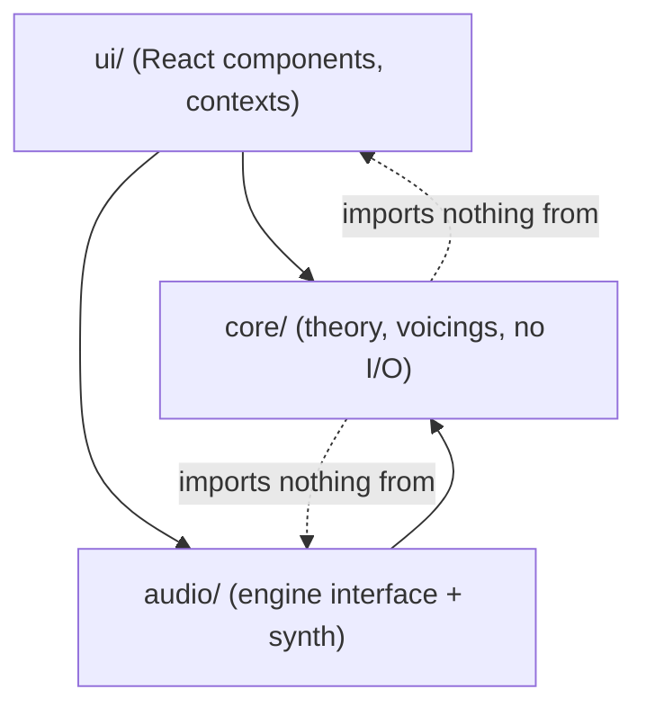
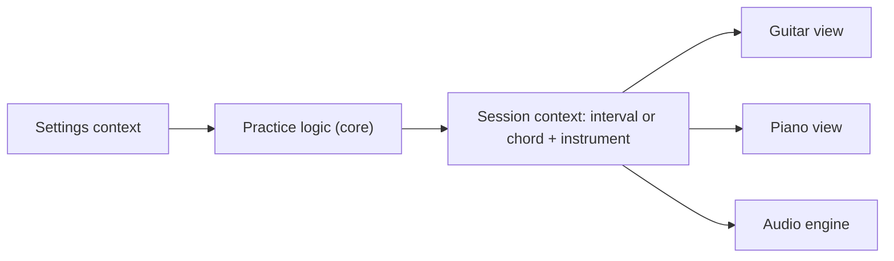

# Architecture Spine — accompa

## Design Paradigm

Ports-and-adapters. The music-theory **core** is pure TypeScript with no React, no DOM and no audio. The **audio engine** and the **React UI** are adapters around it. Dependencies point inward only.



## Invariants & Rules

FR-21 is withdrawn (piano voicings and inversions are Phase 2), so no decision below binds it. Phase 1 generates guitar voicings only.

### AD-1 — Dependency direction

- **Binds:** all
- **Prevents:** theory logic leaking into components, or audio details leaking into theory.
- **Rule:** `core/` imports nothing from `ui/` or `audio/`, and uses no browser APIs. `audio/` may import `core/` types only. `ui/` may import both. Enforce with an import-boundary lint rule.

### AD-2 — Pitch is an integer

- **Binds:** FR-3, FR-4, FR-10, FR-12, FR-14, FR-15, FR-16, FR-22
- **Prevents:** the piano view, fretboard, voicing generator and audio disagreeing about what a note is.
- **Rule:** In `core/`, absolute pitch is a MIDI note number (60 = middle C), pitch class is `n mod 12`, and an interval is a semitone count. They are distinct branded TypeScript types (`Pitch`, `PitchClass`, `Interval`), so the compiler stops them mixing. No note-name strings are stored, passed between modules, or compared. A spelled note is a struct of integers (`letter` 0 to 6, `accidental` as a semitone offset), never a string. **[ADOPTED]**

### AD-3 — Spelling is a display function

- **Binds:** FR-4, FR-12, FR-14, FR-15
- **Prevents:** two views labelling the same chord tone differently (C♯ vs D♭, or a wrong dim7 spelling).
- **Rule:** One `core/spelling` module turns pitches into labels. Chord tones are spelled by letter-name stepping from the spelled root (3rd = root letter + 2, 5th = +4, 7th = +6), with accidentals as needed. Root spelling comes from the namer's chosen reading (AD-10) or the user's explicit root change; a default table (D♭, E♭, G♭, A♭, B♭ flat; C♯, F♯ sharp) applies where neither exists. Interval spelling: each of the 12 intervals has one fixed name in the interval table (m2, M2, m3, M3, P4, A4, P5, m6, M6, m7, M7, P8; 6 semitones is always A4), and the upper note is spelled by that interval's letter step. No component spells notes itself. **[ADOPTED]**

### AD-4 — One table per music concept

- **Binds:** FR-7, FR-12, FR-14, FR-20, FR-22
- **Prevents:** the interval pool, the reveal text, the chord builder and the ear-practice pool each keeping their own list of intervals or chord qualities.
- **Rule:** Interval definitions (semitones, name, abbreviation) and chord quality definitions (name, symbol, interval stack) live once as data in `core/theory`. UI lists, practice pools, the namer and the voicing generator all derive from them. Adding a quality means adding one entry there, plus its shape templates (AD-9).

### AD-5 — Session model is instrument-independent

- **Binds:** FR-1, FR-2, FR-10, FR-12, FR-15, FR-16, FR-19, FR-22
- **Prevents:** state that resets or diverges when the user swaps instruments, practice rounds overwriting what the user built, and views owning musical state.
- **Rule:** Session types are plain data defined in `core/model` (reducers live in `ui/`). The session has two separate parts, each with one writer:
  - **workspace** (written only by builder, free-play and voicing editing): the current interval, the chord (spelled root and quality), and the selected voicing per instrument. A guitar voicing carries its string and fret positions (AD-8), so positions survive an instrument swap and swapping back.
  - **practice** (written only by practice rounds): the current question, reveal state, and the chord or interval pool in play.

  Practice never writes to the workspace. The active instrument is separate from both. A view is a pure render of session state.

### AD-6 — State lives in Context plus reducer

- **Binds:** FR-1 to FR-22 (UI)
- **Prevents:** ad hoc component state, and audio mixed into React state.
- **Rule:** React Context with a reducer, split into a **settings** context (interval pool, direction, root mode, sound, theme) and a **session** context (current interval or chord, instrument, voicing selection). Only sound, theme and interval pool persist to `localStorage`; direction, root mode, chord, voicing and the current question do not. State is plain and serializable. Playing a sound is a command to the audio engine, never React state. No other state library is added unless Context demonstrably fails. **[ADOPTED]**

### AD-7 — Audio engine is one interface

- **Binds:** FR-3, FR-11, FR-13, FR-19, FR-20, FR-10
- **Prevents:** components creating Web Audio nodes, and the synth-to-samples change touching the UI.
- **Rule:** `audio/` exposes one engine interface: play an **ordered list** of absolute pitches on an instrument as a block, an arpeggio (in list order, so a descending interval plays descending) or a strum (bass to treble), and stop. Replay repeats the same list. The engine owns note timing; callers pass no timestamps. Components call only that interface. The first implementation is pure Web Audio synthesis; sampled instruments replace it later behind the same interface. The `AudioContext` is created or resumed synchronously inside a user gesture handler (click or keydown), with no enable-sound screen. The engine treats a `suspended` context as "not ready" and resumes it on the next gesture. **[ADOPTED]**

### AD-8 — Voicings: one shape, generation separate from ranking

- **Binds:** FR-16, FR-17, FR-18, FR-19, FR-20
- **Prevents:** guitar and piano voicings needing different naming and audio paths, and ranking rules tangled into generation.
- **Rule:** A voicing is an ordered list of absolute pitches, bass to treble. A guitar voicing adds a per-string fret assignment (or muted). Generation is a pure `core` function: chord, instrument, tuning and constraints in, every playable voicing out, unranked. Ranking is a separate pure function. Its primary key is register distance: the absolute difference between the voicing's mean pitch and the source chord's mean pitch, in semitones, so a high chord surfaces high voicings first (FR-18). Template match breaks ties within a distance bucket, so a fixed open shape ranks first only when it is near the source register. Bucket width is a parameter. Naming and playback take the pitch list and ignore how the voicing was produced. The shape is shared by guitar and piano, but Phase 1 generates guitar voicings only (piano voicings are Phase 2). Voicing parameters are decided defaults, kept in one place as tunable constants in `core/` and revisited only if real voicings feel wrong: max fret span 4 frets (user-confirmed); open strings do not count toward the span; root and 3rd are always present; the 7th is mandatory on seventh chords; only the 5th may be dropped; register distance is mean-pitch distance, as above.

### AD-9 — Common shapes are curated data

- **Binds:** FR-17
- **Prevents:** shape knowledge hard-coded in logic, and silently wrong templates.
- **Rule:** Common shapes are a data file in `core/`. Movable shapes (E-shape and A-shape barres and similar) are defined relative to the root; open shapes are fixed. Voicings that match no template are still listed after the matches. A test asserts every template yields exactly its chord's pitch classes. **Maintenance:** every new chord quality needs its templates added by hand. Without them the quality falls back to generated voicings only. **[ADOPTED]**

### AD-10 — Chord naming returns ranked readings

- **Binds:** FR-12, FR-14, FR-19
- **Prevents:** two surfaces naming the same toggled notes differently (Am7 vs C6).
- **Rule:** The namer is the only path to a chord's name in Phase 1: chords are built by clicking notes (there is no root-and-quality builder; a chord library is Phase 2) and by hand-editing voicings. The namer takes pitches and returns all matching readings as root, quality and optional bass note (so an inversion reads as a slash chord), ranked with the lowest sounding note as root first. The UI shows the first reading large and the rest as clickable alternatives. Choosing an alternative sets the chord's root and its spelling (same pitches, different root, for example C6 vs Am7/C). The default root is the lowest sounding note, and the user can change the root (R). No surface picks its own reading. In Phase 2, a chord library that picks root and quality may bypass the namer.

### AD-11 — Randomness is injected

- **Binds:** FR-5, FR-9, FR-20
- **Prevents:** untestable practice logic and unreproducible bugs.
- **Rule:** Anything random (next interval, random root, next chord) takes a random-number function as a parameter. `core/` never calls `Math.random` directly. Tests pass a seeded function.

## Consistency Conventions

| Concern | Convention |
| --- | --- |
| Naming | TypeScript, `camelCase` values, `PascalCase` types and components. Files named after their main export. Music concepts use standard terms (interval, pitch class, voicing). |
| Data and formats | Pitch is `number` (AD-2). Intervals are semitone `number`. Voicings are readonly arrays. No dates, ids or serialization formats beyond `localStorage` JSON for settings. |
| State | Reducers are pure. Only sound, theme (with manual override of the system setting) and interval pool persist to `localStorage`. Direction, root mode, chord, voicing and the current question do not. Read failures fall back to defaults. |
| Errors | `core/` functions are total over valid input and return empty results, not exceptions, when no voicing exists. Audio failures surface as a UI message and never break theory features. |
| Tests | Vitest on `core/` (logic and risk live there). Light component tests. No end-to-end suite. |
| Instrument parameters | Guitar is six strings, standard tuning (E A D G B E), 22 frets. Tuning is a parameter to core functions so alternate tunings are a later feature, not a rewrite. Each instrument's pitch range is owned by one `core/instruments` module (piano default MIDI 36 to 96, a UX-changeable value). Practice logic picks random roots so every note it plays fits the active instrument's range. |

## Stack

| Name | Version |
| --- | --- |
| TypeScript | 7.0.2 |
| React, react-dom | 19.3.1 |
| @types/react, @types/react-dom | 19.3.0 |
| Vite | 8.3.5 |
| @vitejs/plugin-react | 6.1.2 |
| Vitest | 5.0.5 |
| @testing-library/react | 16.3.3 |
| Node.js | 22.13.1 locally. Vitest governs: ^22.12 or ^24 or >=26 (Vite itself needs ^20.19 or >=22.12). |
| Web Audio API | browser-native, no audio library |

Versions verified against npm on 2026-10-23. Versions are pinned exactly in `package.json`. Target browsers: current Chrome, Edge, Firefox and Safari on a laptop.

Component-test DOM: `happy-dom` (21.0.4) is the default, because `jsdom` 30 needs Node 22.22+ and local Node is 22.13.1. Add a linter only after checking its TypeScript 7 support; `typescript-eslint` currently supports TypeScript below 6.1.

## Structural Seed

Static client-side app. No backend, no accounts, no network calls. Run locally with the Vite dev server. It can be hosted later as a static site with no change.

```text
accompa/
  src/
    core/        # theory, spelling, voicing generation and ranking, shape templates (no I/O)
    audio/       # engine interface and synth implementation
    ui/          # React components, contexts, reducers, instrument views
  tests/         # Vitest specs, mirroring core/
```



## Capability → Architecture Map

| Capability / Area | Lives in | Governed by |
| --- | --- | --- |
| Instrument views, swap (FR-1, FR-2) | `ui/` | AD-5, AD-6 |
| Interval practice and settings (FR-3 to FR-9) | `core/` logic, `ui/` | AD-2, AD-4, AD-6, AD-11 |
| Interval free-play (FR-10) | `ui/` + `core/` | AD-2, AD-4 |
| Sound (FR-11, FR-13, FR-20 playback) | `audio/` | AD-7 |
| Chord builder and naming (FR-12 to FR-14) | `core/`, `ui/` | AD-3, AD-4, AD-10 |
| Fretboard transfer (FR-15) | `ui/` | AD-5 |
| Voicings (FR-16 to FR-20) | `core/` | AD-8, AD-9 |
| Chord ear practice (FR-22) | `core/` logic, `ui/` | AD-4, AD-11 |

## Deferred

- **Sampled piano and guitar:** Phase 2; the sample source is decided then. AD-7 keeps the swap local to `audio/`.
- **Piano voicings and inversions (FR-21, withdrawn) and a chord library by root and quality:** Phase 2.
- **Voicing rules:** parameters inside AD-8 with the defaults stated there (all decided; span 4 user-confirmed, the rest delegated to the team). Revisit only if real voicings feel wrong.
- **Visual design, layout and voicing browsing UX:** decided in the UX spines (DESIGN.md, EXPERIENCE.md).
- **Alternate tunings, other string counts:** a tuning parameter exists (see conventions); no UI yet.
- **Hosting and deployment:** local only. A static host works without change when wanted.
- **Piano keyboard range and fret-region UI:** decided in the UX spines. The piano shows 3 octaves (engine range stays MIDI 36 to 96); the fret region is set by dragging, with the whole neck by default.
- **Later capability areas in the PRD (scales and modes, circle of fifths, progression analysis):** not in Phase 1.
- **Accessibility and keyboard navigation:** decided in the UX spines. Keyboard-first for Listen, mode and instrument switching, transport and voicing stepping; instrument note-toggling and fret-region drag are pointer-only in v1 (see EXPERIENCE.md Accessibility Floor).
